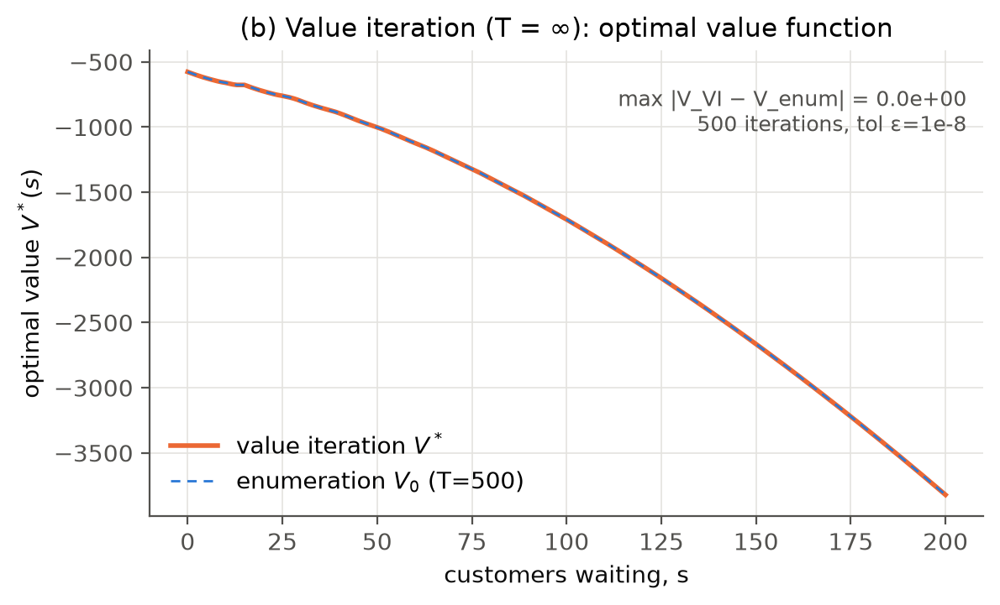
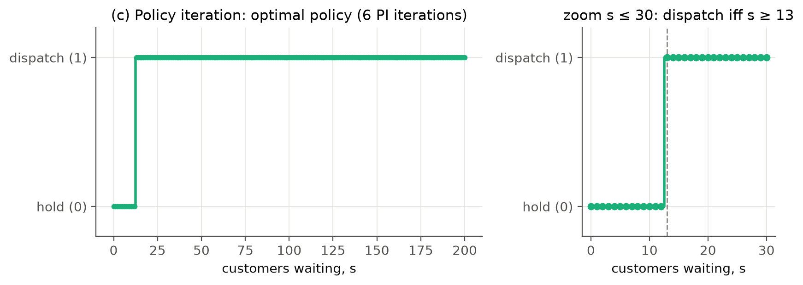
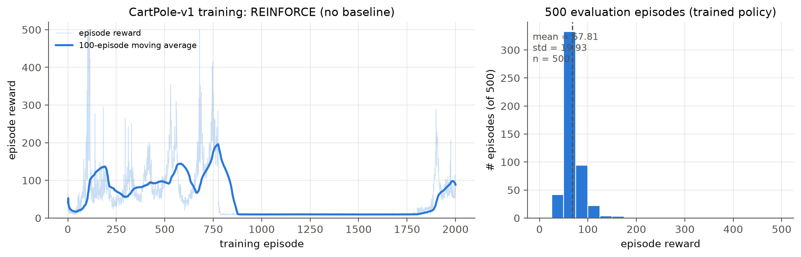
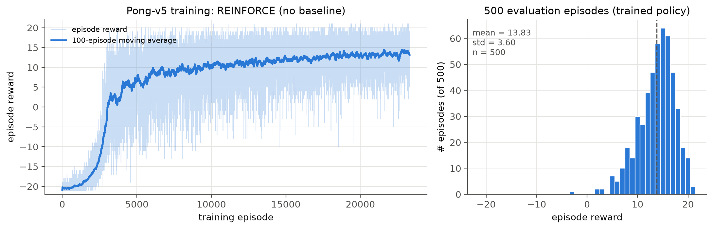
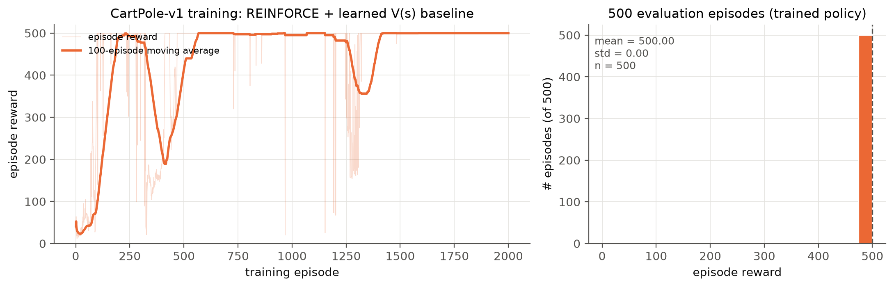
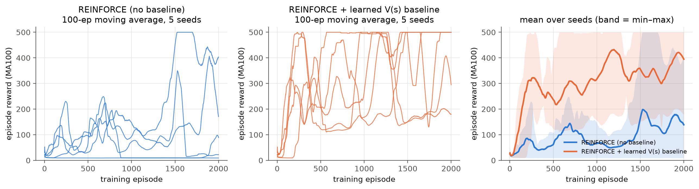
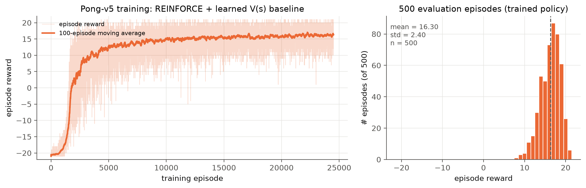
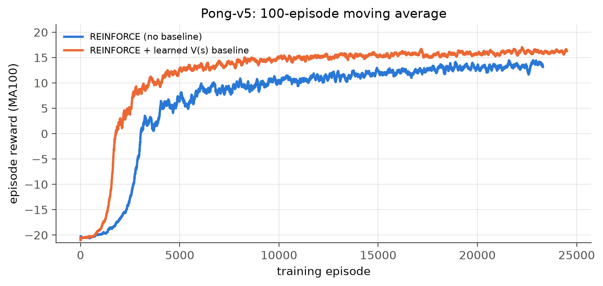
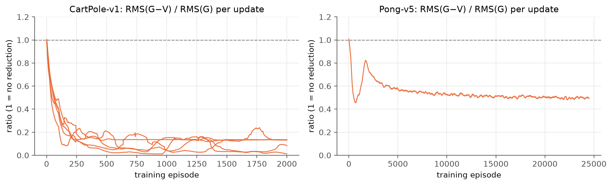

# Submission information {-}

| | |
|---|---|
| GitHub username | `weicheng998` |
| Repository | `mlds490-assignment1` — <https://github.com/weicheng998/mlds490-assignment1> |
| Code | Part 2: `mdp/` · Parts 3 / 3b: `pg/` · launch scripts: `scripts/` · figures and logs: `results/` |
| Compute | Part 2 and the validation scripts: laptop CPU. All policy-gradient training: deepdish, one GPU (`CUDA_VISIBLE_DEVICES=0`), conda env `myenv`, PyTorch cu126 |

**How to run** (full details in `README.md`):

```bash
pip install -r requirements.txt
python -m mdp.run && python -m mdp.validate        # Part 2 (CPU, ~15 s)
nohup bash scripts/run_cartpole.sh      > logs/cartpole.log   2>&1 &
nohup bash scripts/run_pong.sh none  7 > logs/pong_none.log  2>&1 &
nohup bash scripts/run_pong.sh value 7 > logs/pong_value.log 2>&1 &
python -m pg.plot                                  # all PG figures
python -m pg.validate --allow-cpu                  # PG validation (CPU)
python -m pg.validate --allow-cpu --tests variance # needs checkpoints
```

Training requires CUDA and raises an error at startup if it is missing. `--allow-cpu` exists only for local smoke tests and the CPU-only validation scripts.

**How validation was approached.** For every part I wrote down the expected outcome *before* running each test. Where possible, I compared against a computation that does not share code with the solver: a Monte Carlo simulator, a closed form, a brute-force search, or an exact gradient. Two of my own predictions turned out to be wrong; both are reported below, with what they taught me.

# Part 2 — Shuttle dispatch: enumeration, value iteration, policy iteration

## Model

| Element | Definition |
|---|---|
| State | $s\in\{0,1,\dots,200\}$, the number of customers waiting at the start of a period |
| Actions | $a=0$ hold, $a=1$ dispatch (allowed in every state, including $s=0$) |
| After decision | $s^{+}=s-a\cdot\min(s,K)$ with $K=15$ |
| Cost | $c(s,a)=c_f\,a + c_h\,s^{+}$, with $c_f=100$, $c_h=2$ (holding cost charged on customers left after the dispatch) |
| Transition | $s'=\min(s^{+}+A,\,200)$, $A\sim\text{Unif}\{1,\dots,5\}$ |
| Objective | reward $r=-c$, discount $\gamma=0.95$; enumeration uses horizon $T=500$ with $V_T\equiv 0$ |

**Assumptions** (beyond the handout):

1. The order of events within a period is: decision, then holding cost on $s^{+}$, then arrivals.
2. Customers arriving when the station is full (200) are turned away. Their probability mass is lumped at $s'=200$.
3. Dispatching an empty shuttle at $s=0$ is allowed and costs $c_f$.
4. The value is the negative expected discounted cost, so all values are $\le 0$.
5. Ties between actions (within $10^{-9}$) are broken toward *hold*.

**Algorithms** (`mdp/shuttle.py`). I build the two $201\times201$ transition matrices $P_a$ and reward vectors $R_a$ once.

* **(a) Enumeration** is backward induction $V_t=\max_a\{R_a+\gamma P_aV_{t+1}\}$ for $t=499,\dots,0$.
* **(b) Value iteration** starts from $V=0$ and stops when $\lVert V_{k+1}-V_k\rVert_\infty<\varepsilon(1-\gamma)/2\gamma$ with $\varepsilon=10^{-8}$. This guarantees the greedy policy is $\varepsilon$-optimal.
* **(c) Policy iteration** starts from *always hold*. It evaluates each policy exactly by solving $(I-\gamma P_\pi)V=R_\pi$, and switches an action only on strict improvement, so ties cannot cause cycling.

## Results

{width=78%}

{width=78%}

{width=95%}

**Interpretation.** At the threshold, $V^*(13)=V^*(14)=V^*(15)$. Dispatching from any $s\le K$ empties the station, so these states share the value $-100+\gamma\,\mathbb{E}V^*(A)$. Holding at $s=12$ costs 24 now and moves the queue to 13–17 next period, which is cheaper than paying 100 to clear only 12 customers.

{width=100%}

## Edge cases and how each was handled

| Edge case | Handling | Verified by |
|---|---|---|
| Capacity 200 (arrivals would overflow) | $s'=\min(\cdot,200)$; overflow mass lumped at 200 | T1: $P(198\to200\mid\text{hold})=0.8$ (arrivals 2–5); rows sum to 1. T9: re-solving with cap 400 leaves the policy and values unchanged |
| More waiting than seats ($s>K$) | dispatch carries $\min(s,K)$; the rest pay holding cost | T1: $R(\text{dispatch},20)=-100-2\cdot5=-110$; Monte Carlo from $s_0=120,200$ (T4) |
| Empty station ($s=0$) | dispatch allowed, costs 100, never chosen | T1 $R(\text{dispatch},0)=-100$; policy holds at 0 |
| Last periods of a finite horizon | $V_T=0$; backward induction | T8: no dispatch at $t=T-1$ (saves at most $c_hK=30<100$) |
| Ties between actions | tie $\rightarrow$ hold (tolerance $10^{-9}$); PI switches only on strict improvement | PI terminates in 6 iterations, policy equals VI's |
| Degenerate parameters ($c_h=0$, $c_f=0$, small $\gamma$) | none needed; checked that the solver handles them | T6, T7 (analytic predictions below) |

## Validation experiments

Run with `python -m mdp.validate`. Outputs go to `results/mdp/validation.{txt,json}`. All 9 pass.

| # | Experiment and prediction | Result |
|---|---|---|
| T2 | Three solvers agree. Enumeration error must satisfy $\lVert V_0^T-V^*\rVert_\infty\le\gamma^T\lVert V^*\rVert_\infty=2.8\times10^{-8}$ | $4.9\times10^{-9}$ (under the bound); VI vs PI $4.9\times10^{-9}$; identical policies |
| T3 | Bellman residual of the PI solution ≈ 0; VI residual ratio $\le\gamma$ | $\lVert TV-V\rVert_\infty=4.5\times10^{-13}$; ratio 0.95000 |
| T4 | **Independent Monte Carlo simulator.** It is written separately and never uses $P$ or $R$. 4000 episodes × 600 steps per start state ($\gamma^{600}$ is negligible) should match $V^*$ within sampling error | $z$ = 2.23, 1.69, −0.01, 0.85, 0.40 for $s_0$ = 0, 13, 50, 120, 200 (e.g. MC −1001.53 ± 0.48 vs $V^*$ −1001.53) |
| T5 | **Brute force.** Exactly evaluate all 202 threshold policies. The best should equal PI's, and none should beat $V^*$ in any state | best threshold 13, equal to PI's; none better. Never dispatch: $V(0)=-2203.9$; always dispatch: $-2000.0$; optimal: $-576.7$ |
| T6 | **Analytic toy cases.** (i) $c_h=0$: never dispatch, $V^*\equiv0$. (ii) $c_f=0$: dispatch whenever $s\ge1$, and $V^*(s)=0$ for $s\le15$. (iii) Deterministic $A=5$, $K=200$: closed-form cycle value $V(5)=-\frac{\sum_{k=1}^{m-1}\gamma^{k-1}c_h k a+\gamma^{m-1}c_f}{1-\gamma^m}$, optimized over $m$ by hand | (i) $\max\lvert V\rvert=0$, no dispatch. (ii) $\max\lvert V\rvert=2\times10^{-12}$, dispatch for all $s\ge1$. (iii) $m^*=5$, closed form $-759.532035$ = solver $-759.532035$; solver dispatches first at a reachable state $s=25=m^*a$ |
| T7 | **Comparative statics.** The threshold rises with $c_f$, falls with $c_h$, falls with $\gamma$. Analytic bound: a dispatch saves at most $c_hK/(1-\gamma)$, so the policy should never dispatch when $\gamma<1-c_hK/c_f=0.7$ | thresholds: $c_f$ 25/50/100/200/400 $\rightarrow$ 8/11/13/14/15. $c_h$ 0.5/1/2/4/8 $\rightarrow$ 15/14/13/11/8. $\gamma$ 0.5–0.7 $\rightarrow$ never; 0.72 $\rightarrow$ 15, 0.8 $\rightarrow$ 14, 0.9–0.99 $\rightarrow$ 13 |
| T8 | **Finite horizon.** No dispatch at $t=T-1$. A memo-free expectimax recursion (independent code) should equal backward induction for $T=6$ | no dispatch at $T-1$. Expectimax = enumeration to 6 decimals at $s$ = 0, 7, 13, 30 (e.g. −174.724328) |
| T9 | **Cap sensitivity.** Raising the cap to 400 should change nothing, because the optimal policy never lets the queue grow | identical policy; $\max\lvert\Delta V\rvert=2\times10^{-13}$ |

**Two predictions of mine that were wrong.**

* I first predicted $P(198\to200)=0.6$. It is 0.8, because arrivals 2, 3, 4 and 5 all hit the cap.
* In T7, $\gamma=0.5$ produced *no* threshold at all, which broke my monotonicity check. Working out why gave the analytic bound $c_hK/(1-\gamma)<c_f$ that is now part of the test. Removing 15 customers saves at most 30 per period forever. That is worth less than 100 whenever $\gamma<0.7$, and the solver switches exactly there.

**A caveat about independence.** Value iteration from $V_0=0$ is mathematically the same computation as backward induction. Here it also happened to stop after exactly 500 iterations, so $V_{VI}=V_0^{T=500}$ *exactly* (Fig. b). The agreement between (a) and (b) is therefore not independent evidence. The independent evidence is policy iteration (a linear solve), the Monte Carlo simulator, the expectimax recursion, the brute-force threshold search and the closed forms.

**First 10 steps** under the optimal policy from $s_0=0$, with sampled arrivals (from `validation.txt`):

| $t$ | 0 | 1 | 2 | 3 | 4 | 5 | 6 | 7 | 8 | 9 |
|---|---|---|---|---|---|---|---|---|---|---|
| $s_t$ | 0 | 3 | 6 | 10 | 15 | 1 | 2 | 7 | 12 | 14 |
| action | H | H | H | H | **D** | H | H | H | H | **D** |
| cost | 0 | 6 | 12 | 20 | 100 | 2 | 4 | 14 | 24 | 100 |
| $A_t$ | 3 | 3 | 4 | 5 | 1 | 1 | 5 | 5 | 2 | 2 |

The holding cost equals $2s_t$ when holding. Dispatches happen exactly when $s_t\ge13$, and a dispatch at $s\le15$ resets the queue to the arrivals. Starting from $s_0=40$, the policy dispatches three times in a row (40 $\rightarrow$ 30 $\rightarrow$ 18 $\rightarrow$ 5), with costs 150, 130 and 106: $100+2\cdot25$, $100+2\cdot15$, $100+2\cdot3$.

## Given three more months

* Prove the threshold structure rather than observe it, by showing $V^*$ is concave and that $Q(s,1)-Q(s,0)$ is monotone, and check that numerically for all parameter grids.
* Replace the uniform-arrival assumption with Poisson or time-of-day arrivals, and test robustness when the policy is trained on one arrival process and evaluated on another.
* Simulate a discrete-event version of the station with continuous time and real shuttle travel times, and measure how much the discrete-time model's policy loses.
* Add multiple shuttles and a fleet constraint, and check against a mixed-integer solver.
* Compare against the average-cost criterion ($\gamma\to1$) using relative value iteration.
* Fuzz the solver over random $(K,c_f,c_h,\gamma)$, checking every invariant above (agreement, bounds, Monte Carlo) automatically.

# Part 3 — REINFORCE (policy gradient, no baseline)

## Implementation

**Objective.** I maximize $J(\theta)=\mathbb{E}\big[\sum_t\gamma^t r_t\big]$ using the reward-to-go estimator
$$\hat g=\frac1B\sum_{i=1}^{B}\sum_{t}\nabla_\theta\log\pi_\theta(a_t^i\mid s_t^i)\,G_t^i,\qquad G_t=\sum_{k\ge t}\gamma^{k-t}r_k .$$
Returns are **not** normalized, so that Part 3b is a clean comparison. As is standard practice, I drop the $\gamma^t$ factor in front of each term. The toy-MDP test (P2) shows the estimator converges to exactly this target. The optimizer is Adam.

| | CartPole-v1 | Pong-v5 (`ALE/Pong-v5`, default sticky actions 0.25, frameskip 4) |
|---|---|---|
| Input | 4-d state | **difference of consecutive preprocessed frames** (80×80 $\rightarrow$ 6400), values in {−1, 0, 1} |
| Policy net | MLP 4–128–2, ReLU, softmax | MLP 6400–200–2, ReLU, softmax over ALE actions {2, 3} |
| γ | 0.95 | 0.99 |
| Adam lr | 0.01 (as specified) | **1e-3** (see below) |
| Episodes per update | 1 | 10 (collected in parallel by 10 CPU workers) |
| Training length | 2000 episodes × 5 seeds | 7 h time limit, 1 seed (23,300 / 24,510 episodes) |

**Motion in Pong.** A single preprocessed frame shows where the ball is but not where it is going. I use Karpathy's frame-difference input $x_t=\text{pre}(f_t)-\text{pre}(f_{t-1})$: the ball's old position appears as −1 and its new position as +1, which encodes velocity in one 6400-vector. At reset the previous frame is set to the current one, so $x_0=0$. The handout's `preprocess()` is used verbatim. Because it writes into its argument, I always pass a copy of the environment's observation (verified in P4).

**Learning rate for Pong.** Adam lr = 0.01 on a 1.28 M-parameter network with 6400 binary inputs takes steps far larger than the ±1 reward signal supports. I used 1e-3 with 10 episodes per update, close to the RMSProp 1e-3 / 10-episode setting known to work for this architecture.

**Engineering.**

* Rollouts run on CPU copies of the policy. Pong uses worker processes, and every episode in a batch is generated with the same weights, so updates are exactly on-policy.
* Updates run on the GPU. CUDA is checked at startup.
* Checkpoints (model, optimizer, RNG states, episode counter) are written atomically. On resume, the CSV log is truncated to the checkpoint, so a crash cannot duplicate episodes.
* Training episodes use seed $1{,}000{,}003\cdot\text{seed}+i$; evaluation uses $10^9+i$, so the two never overlap.

## Results

**CartPole-v1.** The figure below shows seed 0's training curve and its 500-episode evaluation histogram; the all-seeds figure in Part 3b (left panel) shows all five seeds. Evaluation samples from the stochastic policy using seeds $10^9+i$, which never appear in training.

{width=100%}

| Seed | 0 | 1 | 2 | 3 | 4 | across seeds |
|---|---|---|---|---|---|---|
| eval mean ± std (500 ep.) | 67.8 ± 19.9 | 9.4 ± 0.8 | 106.8 ± 5.5 | 21.6 ± 5.3 | 449.0 ± 63.1 | 130.9 (median 67.8) |
| final MA100 in training | 88.6 | 9.3 | 170.7 | 22.2 | 403.3 | |
| first episode with MA100 ≥ 475 | – | – | – | – | 1510 | |

**Assignment answer (seed 0): mean 67.81, std 19.93 over 500 episodes.** With lr 0.01, one episode per update and no baseline, plain REINFORCE is unreliable. Only seed 4 approaches the 500 cap. Seed 1 collapsed into a near-deterministic "fall at once" policy (9.4 ± 0.8 steps), where $\nabla\log\pi\approx 0$ and learning cannot recover. Seeds 2 and 3 also settled on narrow policies: their std is small (5.5, 5.3) but their mean is low. Low std alone is therefore not a sign of a good policy. The local CPU sweep at the end of the policy-gradient validation section shows the same pattern. lr 0.01 without a baseline has the lowest mean reward over training of any setting (129) and is the only one with a collapsed seed. Its final median is not worse, because the seeds that survive can reach 500.

**Pong-v5.** Training ran for 7 hours (23,300 episodes, $9.0\times10^7$ frames). It starts at the random-policy level of about −20.5. Without a baseline, the 100-episode moving average first crosses 0 (winning as many points as it loses) at episode 3036 and reaches +10 at episode 6703. It ends at +13.2, with a maximum of +14.5. Episodes grow from about 1,100 to about 4,200 frames as rallies get longer.

**Assignment answer (Pong, no baseline): mean 13.83, std 3.60 over 500 evaluation episodes** (median 14, 5–95% range 7 to 19). The agent wins 499 of 500 games to 21. The single loss scored −3. The curve was still rising slowly when the time limit stopped training, so this is not a converged result.

{width=100%}

# Part 3b — REINFORCE with a learned baseline

**Choice of baseline.** I use a state-dependent baseline $b(s)=V_\phi(s)$, a separate network with the same architecture as the policy body and one output. It is trained by Adam (same lr as the policy) to minimize $\frac1N\sum_t(V_\phi(s_t)-G_t)^2$ on the same batch. The policy weight becomes $A_t=G_t-V_\phi(s_t)$, **detached**, so the policy loss never moves $V_\phi$ and the value loss never moves $\pi_\theta$. Any function of the state alone leaves the gradient unbiased, because $\mathbb{E}_{a\sim\pi}[\nabla\log\pi(a\mid s)]\,b(s)=0$. A good $V$ removes the part of $G_t$ that is predictable from $s_t$. P2 checks both properties numerically. No return normalization is used here either, so the only difference from Part 3 is the baseline.

## Results

{width=100%}

{width=100%}

| CartPole, 5 seeds × 2000 episodes | no baseline | V(s) baseline |
|---|---|---|
| eval mean per seed (500 ep.) | 67.8, 9.4, 106.8, 21.6, 449.0 | **500, 500, 500**, 188.9, 178.7 |
| eval std per seed | 19.9, 0.8, 5.5, 5.3, 63.1 | 0, 0, 0, 7.3, 22.7 |
| seeds whose eval is a perfect 500 | 0/5 | 3/5 |
| mean training reward (all 2000 ep., per seed) | 51.9, 9.4, 132.8, 77.9, 200.8 | 451.1, 251.4, 352.5, 259.9, 260.7 |
| first episode with MA100 ≥ 475 | –, –, –, –, 1510 | 191, 1464, 1080, 1174, 250 |

**Assignment answer (seed 0, with baseline): mean 500.00, std 0.00 over 500 episodes.** Every evaluation episode reaches the 500-step cap.

The baseline helps in all five seeds: mean training reward goes from 95 to 315 (averaged over seeds), and all five seeds reach MA100 ≥ 475, against one without. It does **not** make training monotone. Seeds 3 and 4 reached a perfect moving average (at episodes 1174 and 250) and later fell back to about 180–190. With lr 0.01, unnormalized returns and one episode per update, a single large step can still push a solved policy off the plateau. The sweep below shows that V with lr 0.003 is more stable (3/5 seeds end at ≥ 475, against 1/5 at 0.01). I report the lr 0.01 runs as the main result because that is the specified setting.

**Pong-v5 with baseline.** Same seed, lr, batch, preprocessing and 7-hour budget (24,510 episodes).

| Pong-v5 | no baseline | V(s) baseline |
|---|---|---|
| first episode with MA100 ≥ 0 | 3036 | **1773** |
| first episode with MA100 ≥ +10 | 6703 | **3433** |
| first episode with MA100 ≥ +15 | never | 8265 |
| final MA100 (max) | 13.2 (14.5) | **16.3 (17.1)** |
| eval mean ± std (500 ep.) | 13.83 ± 3.60 | **16.30 ± 2.40** |
| eval median, 5–95% range | 14, [7, 19] | 17, [12, 20] |
| games won in evaluation | 499/500 | 500/500 |

**Assignment answer (Pong, with baseline): mean 16.30, std 2.40 over 500 evaluation episodes.** The baseline reaches every milestone in about half the episodes, ends 2.5 points higher, and has a 33% smaller evaluation std. This is one seed per method, because each Pong run takes 7 GPU-hours. The ordering is consistent over the whole run (see the comparison figure), but I cannot give a seed-level confidence interval.

{width=100%}

{width=85%}

## How much variance does the baseline remove?

I measure this in two ways.

1. **Fixed-policy gradient variance (P6).** For each trained baseline checkpoint I sample fresh episodes and compute every episode's policy gradient twice on *the same* episodes: once weighted by $G_t$, once by $G_t-V(s_t)$. The ratio of total variances (trace of the covariance) isolates the baseline's effect. A paired test on the 20 largest gradient coordinates checks that the mean is unchanged (unbiasedness).

I also include the best **constant** baseline $c=\text{mean}(G_t)$ as a third weighting. This shows how much of the reduction a learned $V(s)$ adds beyond simply centring the returns. Each row uses 300 fresh episodes (CartPole) or 40 (Pong) from that run's final policy. Columns 4–6 are ratios of the total gradient variance (trace of the covariance); the last column is the paired test of equal means. The Pong row uses the final 7-hour checkpoint. Outputs: `results/pg/validation_variance{,_pong}.json`.

| Checkpoint | ep. length | $c$ | none / const | const / $V$ | **none / $V$** | max\|z\| |
|----------------------|--------|-------|----------|----------|----------|------|
| CartPole s0, solved | 500 | 19.24 | 54.2 | 1.01 | **54.9** | 0.93 |
| CartPole s1, solved | 500 | 19.24 | 49.2 | 1.04 | **51.2** | 0.95 |
| CartPole s2, solved | 500 | 19.24 | 62.8 | 1.00 | **63.1** | 1.12 |
| CartPole s3, fails | 189 | 17.99 | 9.3 | 47.8 | **446** | 1.42 |
| CartPole s4, fails | 179 | 17.87 | 4.3 | 921 | **3920** | 1.81 |
| Pong, final (7 h) | 3699 | 0.43 | 1.4 | 2.7 | **3.9** | 2.53 |

How to read this:

* **The baseline always reduces variance**: by 51–3920× on CartPole and 3.9× on Pong. The mean gradient does not change. The largest paired |z| over 20 coordinates is 2.53, below the Bonferroni 5% threshold of about 3.0 for 20 tests, so the test finds no bias.
* **On solved CartPole, a constant does all the work.** All $G_t\approx20$, so the gradient variance comes mostly from the common offset, and subtracting 19.24 removes it. $V(s)$ adds only 0–4% on top, because when the pole never falls no state predicts a different return.
* **$V(s)$ matters where returns depend on the state.** On the two seeds whose policy fails at ~180 steps, the states near the end (large angle) predict the fall. $V$ captures that, which gives 48× and 921× more than a constant. In Pong, rewards are ±1 and a constant (0.43) removes little (1.4×). The learned $V$ cuts the variance another 2.7× by predicting from the ball's position and direction whether the next point will be won.
* **Caveats.** These are single-checkpoint measurements, and repeating the CartPole measurement gave ratios within about ±20% (e.g. 46× vs 55× for s0). The Pong row uses only 40 episodes, so its ratio is rough. A checkpoint at 1.75 h gave 3.0–3.4× in two runs, and the final checkpoint gives 3.9×.

2. **Size of the weights during training.** `train.py` logs RMS$(G_t-V(s_t))$ and RMS$(G_t)$ in every update. Their ratio (Figure below) shows how much of the return the value net explains as training goes on.

{width=100%}

**Why it helps.** In CartPole every reward is +1, so all $G_t$ lie in [1, 20]. Without a baseline every sampled action is pushed *up*, and only the size of the push separates good actions from bad ones. That is the high-variance regime in which seed 1 collapsed. Subtracting $V(s_t)$ centres the weight, so actions that did worse than expected are pushed down. In Pong, $G_t$ depends mostly on whether the next point is won. $V(s)$ learns from the frame difference how likely that is, so the remaining advantage concentrates on the few frames around the paddle hit.

# Policy gradient: edge cases

| Edge case | Handling | Verified by |
|---|---|---|
| Pong frame has no motion | frame-difference input | P4: under NOOP only the ball and CPU paddle appear in the difference (≤ 18 pixels), never our paddle's column |
| First Pong step has no previous frame | previous frame := current frame, so input is 0 | P4: first input all zeros |
| `preprocess` mutates its input in place | pass `obs.copy()` | P4: environment observation unchanged |
| Only actions 2/3 allowed | 2-way softmax mapped to (2, 3) | P4: action 2 moves our paddle up by 33.5 px, action 3 down by 43.5 px, NOOP 0 |
| CartPole truncation at 500 steps | treated as end of episode (no bootstrap). With γ = 0.95 only the last ~60 steps get a shrunken $G_t$, and $V(s)$ cannot see time, so the baseline is biased there | trace shows $G_t$ dropping to 1 at $t=499$. Effect on the policy gradient is unbiased in expectation (baseline is state-only), but it adds variance late in solved episodes |
| Policy collapse to a deterministic action (gradient $\rightarrow$ 0) | reported, not hidden; lr / batch / baseline study | sweep below: one no-baseline seed collapsed to ≈ 9 steps |
| Very long Pong episodes / GPU memory | update in chunks of 8192 time steps with gradient accumulation | identical gradient (chunked sum); peak memory bounded |
| Crashes / ssh disconnects | nohup + checkpoint/resume; CSV truncated to the checkpoint | resume tested locally: episodes 0–11 logged once across a kill/restart |
| Train/eval leakage | disjoint seed ranges | by construction |

# Policy gradient: validation experiments

Run with `python -m pg.validate --allow-cpu` (and `--tests variance` for P6). Outputs go to `results/pg/validation_*.{txt,json}`.

**P1 Reward-to-go.**

* Compared against an $O(T^2)$ brute force on random rewards: max error $1.8\times10^{-15}$.
* Limiting cases: γ = 0 gives $G=r$, and γ = 1 gives the reversed cumulative sum (both exact).
* For a full 500-step CartPole episode $G_0=(1-0.95^{500})/0.05=20.000$. This also explains why CartPole returns are small, which matters for the baseline.

**P2 Exact-gradient check (the main correctness test).** The test uses a 2-step MDP with a linear-softmax policy, where $\nabla J$ is available in closed form by autograd on the exact expectation. I feed 20 000 sampled episodes, one at a time, through the **actual `train.update()`** with a zero learning rate and record the gradient.

| Baseline | max \|z\| vs reward-to-go target | max \|z\| vs $\gamma^t$-weighted target | trace Cov(ĝ) |
|---|---|---|---|
| none | 1.51 | 18.7 | 3.54 |
| true $V(s)$ | 0.38 | 23.6 | **1.06** |
| bad $V$ (+5, −3) | 1.25 | 3.3 | 24.70 |

What this shows:

* The estimator's mean matches the analytic gradient within sampling error in all three cases, so any state-only baseline is unbiased.
* It is clearly distinguishable from the $\gamma^t$-weighted target, so the test has the power to catch a mis-discounted estimator.
* The correct baseline cuts the variance 3.3×, and a bad baseline *increases* it 7×. A baseline only helps if $V$ is fitted well.
* Bugs this test would catch: a wrong sign, a missing `detach`, an action-dependent baseline, or off-by-one reward-to-go.

**P3 Reward-sign and zero-learning-rate controls** (CartPole, 500 episodes, 5 seeds, last-50-episode mean length).

| Arm | per-seed length | median | prediction |
|---|---|---|---|
| reward −1 per step | 9.3 9.4 9.4 9.4 9.4 | 9.4 | < 12 for every seed (learns to fall fast) $\checkmark$ |
| lr = 0 | 18.9 28.8 21.2 25.1 21.8 | 21.8 | in (12, 40), i.e. a random policy $\checkmark$ |
| reward +1, no baseline | 205.6 9.3 322.9 107.2 32.2 | 107.2 | > lr = 0 median $\checkmark$ |
| reward +1, value baseline | 148.6 500 138.6 498.4 411.7 | 411.7 | > 100 $\checkmark$ |

My first version of this test predicted median > 100 for the no-baseline arm after 300 episodes. **It failed** (107.9, 9.5, 15.3, 18.6, 73.3). Plain REINFORCE at lr 0.01 with one episode per update is slow and seed-sensitive, and seed 1 collapses into a "fall immediately" policy. All CartPole returns are positive (≈ 1–20), so without a baseline every sampled action is reinforced. An unlucky early run of one action can push the policy to near-determinism, where $\nabla\log\pi\approx0$ and learning stalls. This is exactly the failure mode a baseline addresses, so I kept the failure on record and added the baseline arm.

**P4 Pong input pipeline** (deterministic test env with sticky actions off).

* Actions 2 and 3 move our paddle −33.5 / +43.5 px over 6 frames, and NOOP moves it 0.
* After background erasure only 18 pixels are non-zero, so the 144/109 background codes really are removed.
* The first difference is all zeros.
* Over 30 NOOP steps the difference never touches our paddle's column, and at most 18 pixels change.

**P5 Seeding.** The same seed and weights reproduce an identical episode, and a different seed gives a different one.

**P6 Gradient-variance study** (see Part 3b). At a *fixed* trained policy I compute the per-episode policy gradient with and without the learned $V$ on the same episodes. That isolates the baseline's effect from differences in what the two methods learned.

**First 10 steps** of a CartPole episode with the trained baseline agent (from `validation_*.txt`):

| t | $\theta$ | $\dot\theta$ | $\pi$(right) | a | $G_t$ | $V(s_t)$ | $G_t-V$ |
|---|---|---|---|---|---|---|---|
| 0 | +0.049 | +0.008 | 0.966 | R | 20.000 | 19.242 | +0.758 |
| 1 | +0.049 | -0.269 | 0.142 | L | 20.000 | 19.205 | +0.795 |
| 2 | +0.044 | +0.039 | 0.985 | R | 20.000 | 19.265 | +0.735 |
| 3 | +0.045 | -0.239 | 0.250 | L | 20.000 | 19.227 | +0.773 |
| 4 | +0.040 | +0.067 | 0.993 | R | 20.000 | 19.285 | +0.715 |
| 5 | +0.041 | -0.213 | 0.410 | R | 20.000 | 19.245 | +0.755 |
| 6 | +0.037 | -0.492 | 0.006 | L | 20.000 | 19.057 | +0.943 |
| 7 | +0.027 | -0.188 | 0.444 | L | 20.000 | 19.261 | +0.739 |
| 8 | +0.023 | +0.113 | 0.997 | R | 20.000 | 19.315 | +0.685 |
| 9 | +0.026 | -0.172 | 0.575 | L | 20.000 | 19.268 | +0.732 |

Model `cartpole_value_s0`, evaluation seed $10^9+7$. Cart position and velocity (|x| ≤ 0.03) and the reward (always 1) are omitted for width; the full rows are in `validation_all.txt`. The episode lasts 500 steps and is truncated. $G_t$ at the last three steps is 2.85, 1.95, 1.00.

What I checked against expectations:

* **Physics.** The pole starts leaning right ($\theta>0$). The policy pushes right whenever $\dot\theta>0$ (t = 0, 2, 4, 8) and left after the push has reversed it. This is the expected bang-bang balancing pattern, and θ shrinks from 0.049 to 0.026 over 10 steps.
* **Returns.** $G_t=20(1-0.95^{500-t})=20.000$ to three decimals, as predicted in P1.
* **Value net bias.** $V(s_t)\approx19.25$, not 20, and the advantage is positive (≈ +0.75) at every step. This is the truncation edge case. $V$ cannot see the time step, so it learns the *average* return over all states it was trained on, including the last ~60 steps where $G_t$ shrinks. Prediction: the mean of $G_t$ over a 500-step episode is $20-\tfrac{20}{500}\sum_{k\ge0}0.95^k\cdot0.95\approx 20-0.76=19.24$. That matches the observed 19.25. The state-only baseline stays unbiased for the gradient. The constant offset only adds a little variance (fixed in "three more months").

## Learning-rate / batch stability study (CartPole, 1500 episodes, 5 seeds, CPU)

Each cell: last-100-episode mean reward per seed (seeds 0–4), 1500 episodes, CartPole-v1, γ = 0.95, Adam. Setting = baseline, Adam lr, episodes per update. "first 500" / "all" = mean reward over the first 500 / all episodes; "≥ 475" = seeds whose last-100 mean is at least 475. Run locally on CPU before the main runs to decide whether lr 0.01 is stable (`results/pg/cartpole_lr_sweep.json`).

| Setting | last-100 mean, seeds 0–4 | median | first 500 | all | ≥ 475 |
|------------------------|------------------------------|--------|---------|------|-------|
| none, 0.01, b1 (**spec**) | 433 9 388 499 206 | 388 | 84 | 129 | 1/5 |
| none, 0.01, b5 | 115 456 82 70 92 | 92 | 117 | 155 | 0/5 |
| none, 0.003, b1 | 105 138 366 474 409 | 366 | 169 | 201 | 0/5 |
| none, 0.003, b5 | 250 275 165 187 202 | 202 | 115 | 195 | 0/5 |
| none, 0.001, b1 | 362 221 142 340 455 | 340 | 113 | 201 | 0/5 |
| none, 0.001, b5 | 277 263 285 257 219 | 263 | 46 | 147 | 0/5 |
| V, 0.01, b1 | 191 401 500 267 150 | 267 | 265 | 270 | 1/5 |
| V, 0.003, b1 | 144 464 499 483 500 | 483 | 239 | 305 | 3/5 |

What I concluded:

* lr 0.01 without a baseline is unstable: it has the lowest mean over training (129), and one seed collapsed to 9 steps. Smaller learning rates are slower but never collapse.
* The baseline gives the best early learning (first-500 mean 265 vs 84 at lr 0.01). It also needs a smaller lr to *stay* at 500.
* I kept lr 0.01 for the main runs because the assignment specifies it. I report its instability rather than tuning it away, and the GPU runs above reproduce it.

## Given three more months

* Run 20+ seeds for every configuration and report confidence intervals and rank statistics (e.g. interquartile mean) instead of 5-seed eyeballing.
* Compare frame-difference against 2–4 stacked frames and a CNN, and ablate sticky actions.
* Measure gradient variance throughout training (from saved intermediate checkpoints), not only at the end, and compare constant, time-dependent and learned baselines and GAE(λ).
* Check the estimator against finite-difference gradients of $J$ estimated with common random numbers on CartPole itself, not only on a toy MDP.
* Test robustness and generalization: perturb CartPole physics (pole length, mass) and Pong opponent skill, and evaluate the trained policy out of distribution.
* Add the time step to the value-network input to remove the truncation bias, and test whether that lowers late-episode variance.
